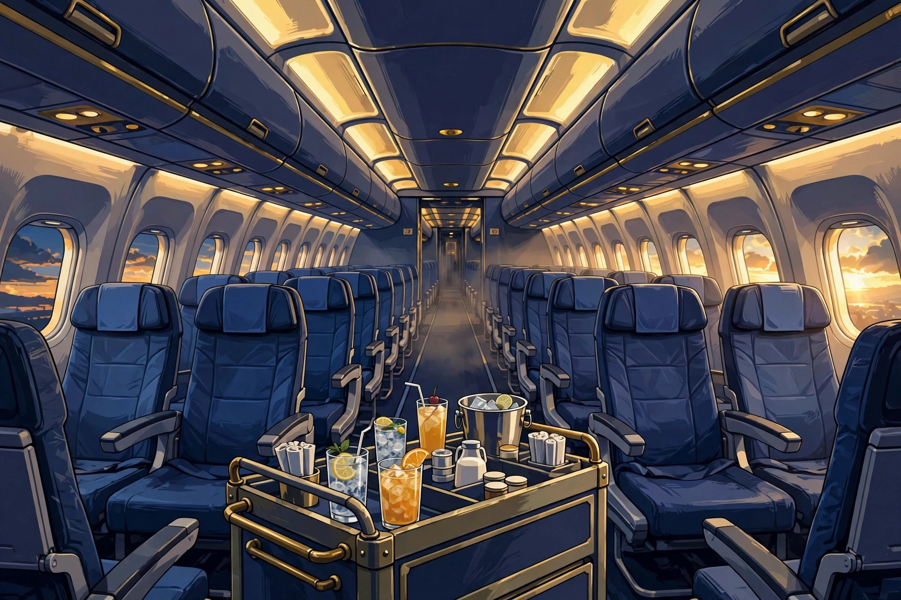

# KrackedDSky

KrackedDSky is a browser-based 3D cabin-service game for players running the KDMirah Crew.

[](https://krackeddsky-kdmirahcrew.vercel.app/)
[](KDMirahCrew/package.json)
[](KDMirahCrew/package.json)
[](LICENSE)

[Play the game](https://krackeddsky-kdmirahcrew.vercel.app/) · [Run locally](#run-locally) · [Controls](#controls)



*Cabin illustration, not a gameplay screenshot.*

Serve passengers, balance your tray through turbulence, and handle cabin incidents. Read PA announcements at the right moment to improve your score and cabin conditions. Earn career XP and Sky Credits, unlock sectors, and upgrade your gear.

## At a glance

| Feature | What it does |
| --- | --- |
| Live 3D cabin | Walk the aisle, interact with passengers and cabin fittings, and switch camera views. |
| Service | Load eight items from the galley; time drink pours and meal plating. |
| Flight conditions | Manage turbulence, tray balance, passenger patience, and safety incidents. |
| PA interphone | Read four announcements with word highlighting and timing bonuses. |
| Career | Progress through seven ranks, six sectors, five commendations, and four gear upgrades. |
| Modes | Fly Economy or VIP, or race a computer-controlled rival in 1v1. |
| Local progress | Keep career, skills, preferences, and top-eight scores in browser storage. |

## Run locally

Install Node.js and npm. From the repository root:

```sh
cd KDMirahCrew
npm ci
npm run dev
```

Open the local URL printed by Vite. Use a browser with WebGL support. Browser speech support and installed voices affect PA playback. The teleprompter uses timed highlighting when speech boundaries are unavailable.

## Your first flight

1. Choose a crew member, appearance, flight sector, mode, and flight count.
2. Select **PLAY**. Follow passenger request icons and load matching items at the galley.
3. Walk to a requesting row and serve. Release drinks inside the target band; stop meal plating inside its target zone.
4. Respond to cabin incidents and turbulence. Use PA announcements when their phase matches the flight.
5. Review your flight audit, career rewards, and leaderboard after the flight.

You can choose one, three, or five flights per match. The career panel contains sectors, ranks, gear, and commendations. Unlocked sectors depend on your rank.

## Controls

| Input | Action |
| --- | --- |
| Click a row or WASD / arrow keys | Walk to a row or move through the cabin |
| 1–8 or item buttons | Load an item at the galley, or walk there automatically |
| Space / E or **SERVE** | Serve nearby passengers; hold and release drinks, or press to stop meal plating |
| C or **PA** | Open the PA picker; press again to hang up |
| G or **SALAM** | Calm nearby guests |
| V or **CAMERA** | Cycle camera views |
| Drag / scroll | Orbit / zoom the camera |
| P / Escape | Pause a flight or close an open menu |

Touch controls include an on-screen joystick, item buttons, and **SERVE**. The camera and cabin fittings also respond to pointer input.

## Build and check

Run these commands inside `KDMirahCrew/`:

```sh
npm run build
npx tsc --noEmit
npm run preview
```

Vite writes the production build to `KDMirahCrew/dist/`. `npm run preview` serves that build locally. There is no automated test script or CI workflow in this repository.

## Project layout

```text
KDMirahCrew/
├── public/images/       Cabin illustration
├── src/
│   ├── App.tsx           Screens, HUD, controls, and flight flow
│   ├── components/       Career panel and game icons
│   └── game/             3D world, simulation, audio, PA, career, and storage
├── package.json          Dependencies and npm scripts
└── vite.config.ts        Vite, React, Tailwind, and single-file build
```

The app uses React, TypeScript, Three.js, Tailwind CSS, and Vite. The 3D engine renders the cabin in WebGL. The production Vite config inlines application JavaScript and CSS into `dist/index.html`. Static assets remain in `dist/` as needed.

## Browser data and limits

Career, skills, preferences, and scores use `localStorage`. Progress stays on the current browser and origin. Clearing site data removes it; this repository has no account sync or server-backed leaderboard. The 1v1 opponent runs in the browser, not over a network. Audio and PA speech depend on browser support and user interaction. WebGL support is required for the cabin.

## Contributing

Keep changes focused on the existing game. Run `npm run build` and `npx tsc --noEmit` from `KDMirahCrew/` before opening a pull request. Include reproduction steps for behavior changes. Do not commit `node_modules/` or `dist/`.

## License

[MIT](LICENSE).
